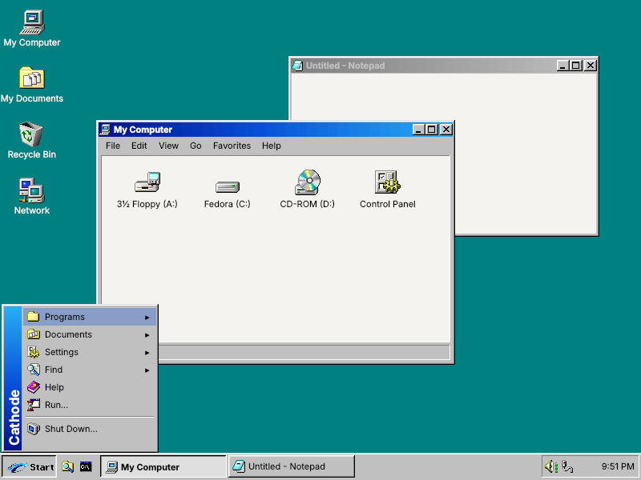
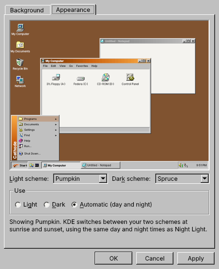
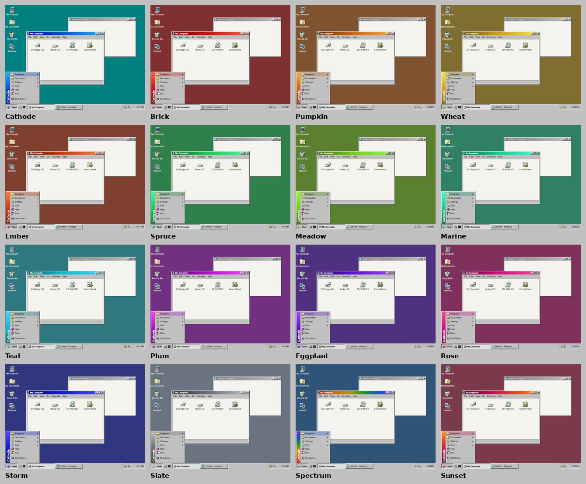
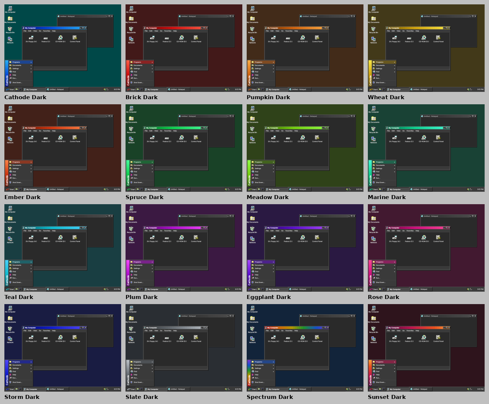
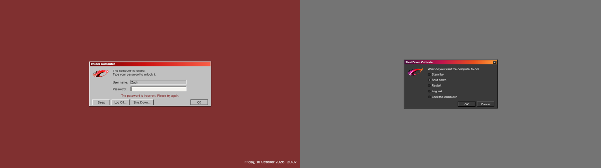

# Cathode — a Windows 98 style desktop for KDE Plasma 6

Classic 98 gray chrome, 3D window frames and the pushed-in Start button. The title bars, selections and loading screens use the colours of the Cathode logo, in 16 colour schemes, each light or dark.



> **Alpha.** Cathode is being tested on Fedora 44 with KDE Plasma 6.6–6.8. Bug reports and screenshots are welcome in [Issues](https://github.com/Zachygd/Cathode-KDE-Theme/issues).

## Install

### Easiest: the installer

1. Download **[Cathode-Installer.run](https://github.com/Zachygd/Cathode-KDE-Theme/releases/latest/download/Cathode-Installer.run)** from the [latest release](https://github.com/Zachygd/Cathode-KDE-Theme/releases/latest).
2. Make it runnable: right-click it → **Properties** → **Permissions** → tick **Is executable**. In a terminal: `chmod +x ~/Downloads/Cathode-Installer.run`.
3. Double-click it (or run `~/Downloads/Cathode-Installer.run`). A terminal opens. Pick light or dark and a colour scheme, then type your password if it asks (that's for installing the Tahoma font and Qt for Python).
4. Log out and back in once.

### One line in a terminal

```bash
curl -fsSL https://raw.githubusercontent.com/Zachygd/Cathode-KDE-Theme/main/get.sh | bash
```

To pass options, put them after `bash -s --`, e.g. `... | bash -s -- --scheme teal --dark`.

### From the source

```bash
git clone https://github.com/Zachygd/Cathode-KDE-Theme.git
cd Cathode-KDE-Theme
./install.sh
```

### What the installer does

- Installs everything to `~/.local/share` for your user. Nothing is written to system folders, except the optional font and Qt for Python packages via `dnf`.
- Downloads the SE98 icons.
- Builds Cathode Start from the Plasma menu source matching your Plasma version. That needs internet and `git`; if it can't, you get Plasma's normal menu.
- Applies the theme and restarts Plasma.
- It **asks before replacing your panels** with the 98 taskbar. Your old settings are backed up next to the originals with a `.cathode-backup` suffix.

Options (for `./install.sh`, or after `--` with the installer):

| Option | |
|---|---|
| `--scheme NAME` | Start with another colour scheme: cathode brick pumpkin wheat ember spruce meadow marine teal plum eggplant rose storm slate spectrum sunset |
| `--dark` | Start in dark mode |
| `--keep-layout` | Change the look but keep your current panels |
| `--plymouth` | Also install the boot animation (asks for your password, rebuilds the initramfs) |
| `--extras` | Also install the Chicago95 GTK theme so GTK apps (Firefox, Steam) match |
| `-y` | Don't ask questions |

**Updating:** run the newer installer over the old one. Your colour choices are kept.

**Uninstalling:** run `./Cathode-Installer.run --uninstall` (or `./uninstall.sh` from the source). That switches back to Breeze and removes Cathode.

### Requirements

- **KDE Plasma 6.** Tested on 6.6, 6.7 and 6.8. Automatic light/dark switching and the Brightness and Color dark mode switch need a Plasma version that has them (6.5 and newer).
- `python3`, `git` and `curl`.
- **Qt for Python (PySide6)** for Display Properties, and the **Wine Tahoma** font. On Fedora the installer adds both. On other distributions, install them with your package manager first; without Tahoma, Cathode uses Noto Sans.

## Display Properties

Open **Display Properties** from the menu (Settings), or run `cathode-display`.



- **Light scheme** and **Dark scheme**: mix and match any two of the 16 schemes.
- **Use: Light, Dark or Automatic.** Automatic lets KDE switch at sunrise and sunset, using the same day and night times as Night Light. The dark mode switch in KDE's **Brightness and Color** menu flips between your two schemes too.
- **Background** tab: the scheme's solid desktop colour, or its wallpaper when it has one.

The light schemes:



<details>
<summary>The dark schemes</summary>



</details>

The lock screen and the Shut Down dialog follow the scheme too:



## What's in it

| Piece | What it does |
|---|---|
| **Global themes** `Cathode` and `Cathode Dark` | One click in System Settings → Colors & Themes → Global Theme: applies everything below, a teal desktop with 32px icons, and the 98 taskbar. Untick "Desktop and window layout" in the dialog to keep your panels as they are |
| **Display Properties** | A 98-style app (in the menu under Settings, or run `cathode-display`) for picking one of **16 colour schemes**: Cathode, Brick, Pumpkin, Wheat, Ember, Spruce, Meadow, Marine, Teal, Plum, Eggplant, Rose, Storm, Slate, Spectrum, Sunset. Pick a **light scheme** and a **dark scheme** (mix and match), then use **Light**, **Dark**, or **Automatic**, which lets KDE switch at sunrise and sunset. The dark mode switch in KDE's **Brightness and Color** menu also flips between your two. The Background tab picks the scheme's solid desktop colour or its wallpaper. OK / Cancel / Apply |
| **Colour schemes** | Each scheme changes the title bars, selections, links, the Start button logo, the Start menu banner, the desktop colour, the system logo icons, and the lock and Shut Down screens. Only the two global themes appear in System Settings; the schemes live in Display Properties so the theme list stays tidy |
| **Window frames** | 3D frames with pixel-exact `_ □ ×` buttons; title bars in a gradient of the scheme colour |
| **Plasma style** | Raised gray taskbar, task buttons (active = pushed in), gray 98 right-click menus, hover in a light tint of the scheme colour, yellow tooltips. Includes the `solid/` and `opaque/` variants so nothing falls back to Breeze |
| **Cathode Start** | Plasma's cascading Application Menu, patched so the Start button **pushes in while the menu is open**, with a vertical **Cathode** banner, no group separator lines, and apps-only search in one column |
| **Cathode Clock** | Taskbar clock that draws the 98 **sunken notification-area box** around itself *and* the tray icons (set to 16px, like 98). Click it for a calendar |
| **Colors** | Light: the 98 gray chrome with soft off-white text fields and lists. Dark: dark gray chrome with the same bevels. Selection colours are kept dark enough for white text in every scheme |
| **Font** | Wine Tahoma 9pt (LGPL; Fedora 44 calls the package `wine-tahoma-fonts-system`, older releases `wine-tahoma-fonts`). The installer installs it, and falls back to Noto Sans if it can't |
| **Icons** | SE98 (Win98SE-style) set, with the Cathode "C" logo on the Start button and as the system logo |
| **Cursors** | ModernXP (prebuilt, shadows included) |
| **Sounds** | KDE-3-Sounds (classic KDE 3 system sounds) |
| **Login splash** | The animated Cathode logo on black, with a sweeping bar in the logo blues |
| **Cathode shell** | A small Plasma shell package (`org.cathode.desktop`) that holds the lock screen and Shut Down dialog. Since Plasma 6.8 those come from the desktop shell rather than the global theme. Everything else falls back to Plasma's standard desktop shell |
| **Lock screen** | A 98-style "Unlock Computer" dialog on the scheme's desktop colour, with the date and time. **Sleep**, **Log Off…** (asks first) and **Shut Down…** (Shut down / Restart / Hibernate / Switch user) buttons. If it ever fails to load, Plasma falls back to its built-in lock screen, so it can't lock you out |
| **Sign-out screen** | The 98 "Shut Down Cathode" dialog: the screen dims and you pick Stand by / Shut down / Restart / Log out / Lock, then OK (arrow keys + Enter work, Esc cancels) |
| **Boot animation** *(optional)* | The same animation as a Plymouth theme, with progress bar and disk-password prompt |

App widgets (buttons, checkboxes, scrollbars inside Qt/KDE apps) use Qt's built-in **Windows** style, colored by the Cathode palette.

### Command line and how it works

Display Properties needs Qt for Python (`python3-pyside6`); the installer installs it with dnf if it's missing. From a terminal: `cathode-display --list`, `cathode-display --apply teal --dark`, or `cathode-display --light-scheme wheat --dark-scheme storm --auto`.

How the light/dark switching works: Display Properties makes the **Cathode** global theme carry your light scheme and **Cathode Dark** your dark scheme. It then sets them as KDE's light and dark global themes, so KDE's own day/night switching and the Brightness and Color dark mode switch do the work. On a system-wide install it makes a small per-user copy of those two themes; a per-user install is changed in place. A small helper started at login (`cathode-display --watch`) sets the matching desktop colour whenever the scheme changes, because global themes can't carry a desktop colour.

## Install system-wide / Cathode spin

```bash
sudo ./install.sh --system --make-default --plymouth
```

Installs to `/usr/share` and writes `/etc/xdg` defaults (`LookAndFeelPackage=org.cathode.desktop`, cursors, sounds), so new users start on Cathode with the 98 taskbar.

In a kickstart, copy this folder into the image and run it in `%post`. It needs network access for SE98 and the Start-menu source, or pass `--icons-from /path/to/SE98`:

```
%post
/opt/cathode-theme/install.sh --system --make-default --plymouth --icons-from /opt/SE98
%end
```

## Known limits

- **Switching shells.** The installer switches Plasma to the Cathode shell, and Plasma keeps panels per shell, so it copies your current panels across first. Panel sizes set by hand may reset once. `./uninstall.sh` switches back, and your original panels are untouched.

- **Menu hover.** Plasma's menus only switch to white text when an item is pressed, so hover uses a light tint of the scheme colour (black text stays readable). Pressed items use the full scheme colour with white text.
- **Wallpapers.** None ship yet. Drop `<scheme>.png` (or `<scheme>-dark.png`) into `~/.local/share/cathode/wallpapers/` (or `share/cathode/wallpapers/` in the source before installing) and Display Properties enables its Wallpaper option for that scheme.
- **Brightness and Color switch.** Like any KDE theme change from that menu, it turns Automatic off. Choose Automatic again in Display Properties (or System Settings) to resume day/night switching.
- **Boot and login animation** stay in the standard Cathode blue whatever the scheme.
- **Tray box.** Cathode Clock finds the system tray next to it and draws the box around both. If you move the clock away from the tray, the box only wraps the clock.
- **Fonts.** Wine Tahoma when available, otherwise Noto Sans. MS Sans Serif isn't free to ship.
- **White vs. gray in apps.** Qt and KDE apps use one "view" color for both text fields/lists *and* whole pages (System Settings, Discover), so pages come out white where 98 dialogs were gray. Making pages gray would also make text fields gray, so the theme keeps 98's white fields.
- **Fractional scaling.** At 125%/150% the 1-pixel bevels get scaled, so edges look slightly softer than at 100%.

## Adding or changing colour schemes

Every scheme is one line in `build/schemes.py` (name, hue, and optional logo tweaks). Run `./build.sh` and it generates everything for it:
- the light and dark `.colors` files
- window frames
- Start buttons
- the recoloured logo and icon theme
- the lock screen logo
- the scheme table used by Cathode Start, the lock screen and Display Properties
- previews, when you give it `SE98=/path/to/SE98`

The light/dark chrome itself (grays, bevels) is in `PALETTES` in `build/svgkit.py`.

## Making a release

1. Put the new version number in `VERSION`, and add a `## <version>` section to `CHANGELOG.md` (it becomes the release notes).
2. Commit and push to `main`.
3. GitHub Actions builds `Cathode-Installer.run` and `Cathode-KDE-Theme.tar.gz`, then creates the tag `v<version>` and the release. Versions below 1.0 are marked as pre-releases. To build the files yourself, run `packaging/make-release.sh`, which writes them to `dist/`.

## Rebuilding

Everything is generated from `build/*.py`. Run `./build.sh` after changing colors (`build/svgkit.py`), geometry, logos or the storyboard (`build/logo/`). `build/framesim.py` renders the SVGs through Qt's own SVG engine for previews.

## Credits & licenses

- Cathode theme files: GPL-2.0-or-later (see [LICENSE](LICENSE)).
- **SE98 icons** by nestoris ([Win98SE](https://github.com/nestoris/Win98SE)), GPL-2.0. Downloaded at install time.
- **ModernXP cursors** by na0miluv ([modernXP-cursor-theme](https://github.com/na0miluv/modernXP-cursor-theme)), GPL-3.0. Prebuilt in `share/cursors/ModernXP`, license included.
- **KDE-3-Sounds** by os-guy ([kde-3.3-sound-pack](https://github.com/os-guy/kde-3.3-sound-pack)), GPL-3.0. Bundled in `share/sounds/KDE-3-Sounds`, license included.
- **Cathode Start** is built from KDE's Kicker ([plasma-desktop](https://github.com/KDE/plasma-desktop)), GPL-2.0-or-later.
- **Chicago95** GTK theme by grassmunk ([Chicago95](https://github.com/grassmunk/Chicago95)), GPL-3.0/MIT. Optional, downloaded with `--extras`.
- Contains no Microsoft files. All window and taskbar artwork is drawn from scratch.
